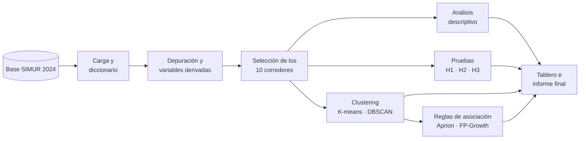

<div align="center">

# 🚦 Siniestralidad vial en los corredores de Bogotá

**Análisis de patrones de siniestralidad vial en corredores principales de Bogotá mediante minería de datos**


*Proyecto de Metodología de la Investigación · Ingeniería de Sistemas*

</div>

---

## 📌 De qué trata

En Bogotá los siniestros viales no se reparten de forma pareja: algunos corredores, horarios y actores viales concentran muchos más eventos que otros. Los tableros oficiales cuentan siniestros, pero un conteo no dice **si una concentración es mayor de lo esperable** ni **qué condiciones tienden a presentarse juntas**.

Este proyecto toma **todos los siniestros de 2024** registrados en la base del **SIMUR** en los **10 corredores con más registros** y combina:

- 📊 **Estadística** para describir su distribución y contrastar hipótesis.
- ⛏️ **Minería de datos** para descubrir perfiles (clustering) y combinaciones frecuentes (reglas de asociación).

> **Pregunta de investigación.** ¿Qué patrones espaciales, temporales y de actor vial presentan los siniestros viales ocurridos en 2024 en los principales corredores de Bogotá, cuáles de ellos son estadísticamente significativos y cómo pueden identificarse mediante técnicas de minería de datos?

## 🧪 Hipótesis

| | Hipótesis | Prueba | Tamaño del efecto |
|---|---|---|---|
| **H1** | Algunos corredores concentran más siniestros de los esperados por su longitud | χ² de bondad de ajuste | V de Cramér |
| **H2** | La gravedad depende de la franja horaria y del tipo de día (las noches de fin de semana son más graves) | χ² de independencia | V de Cramér |
| **H3** | Los siniestros con motocicleta tienen mayor proporción de víctimas | Prueba z de proporciones (unilateral) | Razón de momios (IC 95 %) |

Nivel de significancia α = 0,05 con corrección de Bonferroni.

## 🗺️ Flujo del análisis



## 📁 Estructura del repositorio

```text
siniestralidad-vial-bogota/
├── docs/                  # Documento del proyecto (copia del .tex de letX)
│   └── main.tex
├── data/
│   ├── raw/               # Base original del SIMUR (no se sube a GitHub)
│   └── processed/         # Base limpia de los 10 corredores
├── src/siniestralidad/    # Código del programa
│   ├── config.py          # Rutas, año, franjas, columnas y parámetros
│   ├── carga.py           # Lectura del Excel del Anuario 2024
│   ├── diccionario.py     # Diccionario de variables
│   ├── corredores.py      # Corredor a partir de la dirección y top 10
│   ├── depuracion.py      # Limpieza, trazabilidad y variables derivadas
│   └── preparar.py        # Etapas 1 a 3 de punta a punta
├── notebooks/             # Exploración y gráficos
├── reports/
│   ├── tablas/            # Tablas que genera el programa (CSV)
│   └── figuras/           # Gráficos y mapas
└── tests/                 # Pruebas automáticas con datos de ejemplo
```

## 🚀 Cómo ejecutarlo

```bash
# 1. Clonar e instalar (idealmente dentro de un entorno virtual)
git clone https://github.com/g8martinezsilva/siniestralidad-vial-bogota.git
cd siniestralidad-vial-bogota
python -m venv .venv && source .venv/bin/activate   # En Windows: .venv\Scripts\activate
pip install -r requirements.txt

# 2. Descargar la base del SIMUR y guardarla en data/raw/ (ver data/README.md)

# 3. Construir la base de análisis
python -m siniestralidad.preparar
```

El paso 3 deja en `reports/tablas/` el diccionario de variables, los corredores seleccionados, la trazabilidad de la depuración y el porcentaje de nulos en las variables clave, y en `data/processed/` la base limpia.

Pruebas: `pytest`.

## ✅ Avance

| Objetivo | Etapa | Estado |
|---|---|---|
| **OE1** Base depurada y documentada | Carga, diccionario, corredores, depuración | 🟡 Código listo, falta correrlo con la base real |
| **OE2** Distribución espacial y temporal | Frecuencias, tasas por km, mapas y gráficos | ⚪ Pendiente |
| **OE3** Contraste de hipótesis | H1, H2 y H3 | ⚪ Pendiente |
| **OE4** Perfiles de siniestralidad | K-means y DBSCAN | ⚪ Pendiente |
| **OE5** Reglas de asociación | Apriori o FP-Growth | ⚪ Pendiente |
| **OE6** Tablero e informe | Tablero con 4 vistas e informe final | ⚪ Pendiente |

## 🌿 Ramas

Cada objetivo se desarrolla en su propia rama y entra a `main` con un pull request cuando sus entregables están listos.

| Rama | Objetivo |
|---|---|
| `oe1-base-de-datos` | OE1 |
| `oe2-descriptivo` | OE2 |
| `oe3-hipotesis` | OE3 |
| `oe4-clustering` | OE4 |
| `oe5-reglas-asociacion` | OE5 |
| `oe6-tablero-informe` | OE6 |

## 📚 Datos

**Base Anuario de Siniestralidad 2024**, Secretaría Distrital de Movilidad · [Datos Abiertos Bogotá](https://datosabiertos.bogota.gov.co/dataset/anuario-siniestralidad/resource/35168f38-f3b3-4411-a0c5-545f3ec8869e). Cada registro corresponde a un Informe Policial de Accidente de Tránsito (IPAT). Más detalles en [`data/README.md`](data/README.md).

## 👥 Equipo

| Integrante | Código |
|---|---|
| Gámez Camilo Andrés | 20231020193 |
| Martínez Silva Gabriela | 20231020205 |
| Velasco Rodríguez Carol Stefanya | 20231020215 |
| Molina Diaz Kaleth | 20232020096 |

**Docente:** Rafael Antonio Acosta Rodríguez · Metodología de la Investigación · Facultad de Ingeniería, Ingeniería de Sistemas · Universidad Distrital Francisco José de Caldas

---

<div align="center">
<sub>Los resultados describen asociaciones en los registros, no causas. Las propuestas preventivas que se deriven son alternativas sujetas a validación institucional.</sub>
</div>
