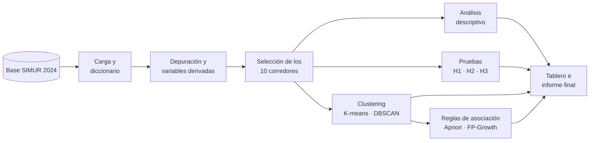

<div align="center">

# 🚦 Siniestralidad vial en los corredores de Bogotá

**Análisis de patrones de siniestralidad vial en corredores principales de Bogotá mediante minería de datos**


*Proyecto de Metodología de la Investigación · Ingeniería de Sistemas*

</div>

---

## 📌 De qué trata

En Bogotá los siniestros viales no se reparten de forma pareja: algunos corredores, horarios y actores viales concentran muchos más eventos que otros. Los tableros oficiales cuentan siniestros, pero un conteo no dice **si una concentración es mayor de lo esperable** ni **qué condiciones tienden a presentarse juntas**.

Este proyecto toma **todos los siniestros de 2024** registrados en la base del **SIMUR** en los **10 corredores con más registros** y combina:

- 📊 **Estadística** para describir su distribución y contrastar hipótesis.
- ⛏️ **Minería de datos** para descubrir perfiles (clustering) y combinaciones frecuentes (reglas de asociación).

> **Pregunta de investigación.** ¿Qué patrones espaciales, temporales y de actor vial presentan los siniestros viales ocurridos en 2024 en los principales corredores de Bogotá, cuáles de ellos son estadísticamente significativos y cómo pueden identificarse mediante técnicas de minería de datos?

## 🧪 Hipótesis

| | Hipótesis | Prueba | Tamaño del efecto |
|---|---|---|---|
| **H1** | Algunos corredores concentran más siniestros de los esperados por su longitud | χ² de bondad de ajuste | V de Cramér |
| **H2** | La gravedad depende de la franja horaria y del tipo de día (las noches de fin de semana son más graves) | χ² de independencia | V de Cramér |
| **H3** | Los siniestros con motocicleta tienen mayor proporción de víctimas | Prueba z de proporciones (unilateral) | Razón de momios (IC 95 %) |

Nivel de significancia α = 0,05 con corrección de Bonferroni.

## 🗺️ Flujo del análisis



## 📁 Estructura del repositorio

```text
siniestralidad-vial-bogota/
├── docs/                  # Documento del proyecto (copia del .tex de letX)
│   ├── main.tex
│   └── propuestas.md      # Propuestas preventivas (OE6)
├── data/
│   ├── raw/               # Base original del SIMUR (no se sube a GitHub)
│   ├── external/          # Longitud de los corredores
│   └── processed/         # Base limpia de los 10 corredores
├── src/siniestralidad/    # Código del programa
│   ├── config.py          # Rutas, año, franjas, columnas y parámetros
│   ├── carga.py           # Lectura de la base del SIMUR (.xlsx o .zip con CSV)
│   ├── diccionario.py     # Diccionario de variables
│   ├── corredores.py      # Corredor a partir de la dirección y top 10
│   ├── depuracion.py      # Limpieza, trazabilidad y variables derivadas
│   ├── preparar.py        # OE1: etapas 1 a 3 de punta a punta
│   ├── descriptivo.py     # OE2: frecuencias, tasas por km y cruces
│   ├── graficos.py        # OE2: gráficos y mapas
│   ├── describir.py       # OE2: genera tablas y figuras
│   ├── hipotesis.py       # OE3: pruebas de H1, H2 y H3
│   ├── contrastar.py      # OE3: genera la tabla de resultados
│   ├── clustering.py      # OE4: K-means, DBSCAN y fichas de perfiles
│   ├── agrupar.py         # OE4: genera perfiles, zonas y figuras
│   ├── asociacion.py      # OE5: FP-Growth, selección y lectura de reglas
│   ├── asociar.py         # OE5: genera las tablas de reglas
│   ├── tablero.py         # OE6: datos, filtros e indicadores del tablero
│   └── app.py             # OE6: tablero en Streamlit
├── notebooks/             # Exploración y gráficos
├── reports/
│   ├── tablas/            # Tablas que genera el programa (CSV)
│   └── figuras/           # Gráficos y mapas
└── tests/                 # Pruebas automáticas con datos de ejemplo
```

## 🚀 Cómo ejecutarlo

```bash
# 1. Clonar e instalar (idealmente dentro de un entorno virtual)
git clone https://github.com/g8martinezsilva/siniestralidad-vial-bogota.git
cd siniestralidad-vial-bogota
python -m venv .venv && source .venv/bin/activate   # En Windows: .venv\Scripts\activate
pip install -r requirements.txt

# 2. Descargar la base del SIMUR y guardarla en data/raw/ (ver data/README.md)

# 3. Construir la base de análisis (OE1)
python -m siniestralidad.preparar

# 4. Análisis descriptivo (OE2)
python -m siniestralidad.describir

# 5. Contraste de hipótesis (OE3)
python -m siniestralidad.contrastar

# 6. Perfiles de siniestralidad (OE4)
python -m siniestralidad.agrupar

# 7. Reglas de asociación (OE5)
python -m siniestralidad.asociar

# 8. Tablero analítico (OE6)
streamlit run src/siniestralidad/app.py
```

El paso 3 deja en `reports/tablas/` el diccionario de variables, los corredores seleccionados, la trazabilidad de la depuración y el porcentaje de nulos en las variables clave, y en `data/processed/` la base limpia. El paso 4 agrega las tablas `oe2_*.csv` y, en `reports/figuras/`, los gráficos y el mapa interactivo. El paso 5 deja `oe3_resultados.csv` con el estadístico, el p-valor, el tamaño del efecto y la decisión de cada hipótesis. El paso 6 deja las fichas de los perfiles (`oe4_perfiles.csv`) y las zonas densas (`oe4_zonas_densas.csv`). El paso 7 deja las reglas de asociación (`oe5_*.csv`), entre ellas las 10 seleccionadas con su lectura en palabras y las que terminan en siniestros con muertos. El paso 8 abre el tablero en el navegador, con cinco vistas: mapa, comportamiento temporal, hipótesis, perfiles y reglas.

Pruebas: `pytest`.

En Windows, si `pip` o `python` no se reconocen, crea el entorno con la ruta completa de Python y habilita la activación solo para esa ventana:

```powershell
& "$env:LOCALAPPDATA\Programs\Python\Python312\python.exe" -m venv .venv
Set-ExecutionPolicy -Scope Process -ExecutionPolicy Bypass
.venv\Scripts\activate
python -m pip install -r requirements.txt
python -m streamlit run src/siniestralidad/app.py
```

## 🔎 Resultados principales

- **H1:** los siniestros no se reparten según la longitud de los corredores (χ² = 623,7; V = 0,14). La Carrera 10, la NQS y la Calle 6 tienen muchos más de los esperados.
- **H2:** la gravedad depende de la franja (V = 0,10) y del tipo de día (V = 0,09). Las noches de fin de semana tienen más siniestros con muertos (7,4 % frente a 5,2 %).
- **H3:** con motocicleta, el 96 % de los siniestros tiene víctimas, frente al 85 % sin ella (razón de momios 4,26).
- **Perfiles:** 7 perfiles con K-means; el de atropellos es el más grave (11,5 % con muertos). DBSCAN encuentra 62 zonas densas; la mayor es la Carrera 10 con Calle 1 (73 siniestros).
- **Reglas:** 217 reglas con FP-Growth. Las más asociadas a muertes son la velocidad (lift 8,3) y la carga en la Avenida Boyacá (lift 4,4).
- **Propuestas:** cuatro propuestas preventivas en [`docs/propuestas.md`](docs/propuestas.md).

## ✅ Avance

| Objetivo | Etapa | Estado |
|---|---|---|
| **OE1** Base depurada y documentada | Carga, diccionario, corredores, depuración | ✅ 3.624 siniestros en 10 corredores |
| **OE2** Distribución espacial y temporal | Frecuencias, tasas por km, mapas y gráficos | ✅ 9 tablas, 6 gráficos y 2 mapas |
| **OE3** Contraste de hipótesis | H1, H2 y H3 | ✅ Se rechaza H0 en las tres |
| **OE4** Perfiles de siniestralidad | K-means y DBSCAN | ✅ 7 perfiles y 62 zonas densas |
| **OE5** Reglas de asociación | FP-Growth | ✅ 217 reglas y 10 interpretadas |
| **OE6** Tablero e informe | Tablero con 5 vistas y propuestas preventivas | ✅ Tablero y 4 propuestas; falta pasarlas al documento |

## 🌿 Ramas

Cada objetivo se desarrolla en su propia rama y entra a `main` con un pull request cuando sus entregables están listos.

| Rama | Objetivo |
|---|---|
| `oe1-base-de-datos` | OE1 |
| `oe2-descriptivo` | OE2 |
| `oe3-hipotesis` | OE3 |
| `oe4-clustering` | OE4 |
| `oe5-reglas-asociacion` | OE5 |
| `oe6-tablero-informe` | OE6 |

## 📚 Datos

**Base Anuario de Siniestralidad 2024**, Secretaría Distrital de Movilidad · [Datos Abiertos Bogotá](https://datosabiertos.bogota.gov.co/dataset/anuario-siniestralidad/resource/35168f38-f3b3-4411-a0c5-545f3ec8869e). Cada registro corresponde a un Informe Policial de Accidente de Tránsito (IPAT). Más detalles en [`data/README.md`](data/README.md).

## 👥 Equipo

| Integrante | Código |
|---|---|
| Gámez Camilo Andrés | 20231020193 |
| Martínez Silva Gabriela | 20231020205 |
| Velasco Rodríguez Carol Stefanya | 20231020215 |
| Molina Diaz Kaleth | 20232020096 |

**Docente:** Rafael Antonio Acosta Rodríguez · Metodología de la Investigación · Facultad de Ingeniería, Ingeniería de Sistemas · Universidad Distrital Francisco José de Caldas

---

<div align="center">
<sub>Los resultados describen asociaciones en los registros, no causas. Las propuestas preventivas que se deriven son alternativas sujetas a validación institucional.</sub>
</div>
